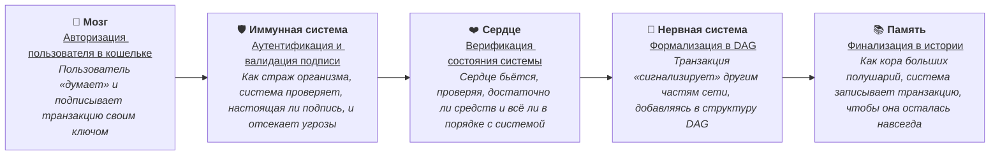

# Ятѣ: неизменяемая, доказуемая, распределённая платформа обмена ценностями

# Введение

Ять — это распределённая финансовая платформа нового поколения, основанная на графовой архитектуре DAG и эллиптической криптографии Ed25519. В отличие от классических блокчейнов, Ять не использует блоки и майнинг: каждая транзакция подтверждает другие, формируя связный, параллельный и масштабируемый граф состояний.

Система уже включает работающее ядро DAG, поддержку подписей, консенсус на основе Raft и чётко определённую архитектуру валидации, формализации и финализации транзакций. Внутренняя единица — `$YAT` — используется не для спекуляции, а для управления, стейкинга и DAO.

Ять не создаёт очередную спекулятивную монету — он формирует надёжную цифровую экономику, где ценности не только передаются, но и управляются прозрачно, доказуемо и без посредников.

---

# 1. Проблемы современной финансовой системы

## 1.1 Централизованное доверие как уязвимость

Современная финансовая система основана на доверии к централизованным учреждениям: банкам, платёжным системам, правительствам и регуляторам. Однако история показывает, что это доверие — не гарант, а зачастую источник риска.

- В марте 2013 года Кипр закрыл банки на две недели в рамках спасательного плана ЕС и МВФ, ограничив снятие средств и переводы для миллионов вкладчиков. Ограничения на международные переводы сохранялись до апреля 2015 года, подорвав доверие к банковской системе.
- В июне–июле 2015 года Греция ввела контроль капитала на фоне долгового кризиса, закрыв банки на три недели и ограничив снятие наличных до 60 евро в день. Это затронуло миллионы граждан, вызвав панику и экономическую нестабильность.
- В 2018 году санкции США и обвал лиры привели к заморозке счетов, связанных с международными транзакциями, в турецких банках. Ограничения, затронувшие бизнесы и частных лиц, продолжались в 2019–2020 годах, усиливая финансовые трудности.
- С октября 2019 года ливанские банки ограничили снятие средств из\-за девальвации лиры и нехватки валюты, заморозив депозиты миллионов граждан. Это вызвало массовые протесты и усугубило гуманитарный кризис.
- В феврале 2022 года Канада заморозила около 210 счетов на 7,8 млн канадских долларов участников протестов против ковидных ограничений. Заморозка без судебного решения вызвала споры о нарушении гражданских прав.
- В 2022 году заморозка активов пользователей российских банков из‑за санкций стала шоком для многих: не имея физического контроля над своими активами, они не могли воспользоваться даже своими личными сбережениями.

В этих примерах уязвимость очевидна: реальным владельцем активов является не человек, а посредник, обладающий правом вето. И в любой момент — по политическим, экономическим или техническим причинам — доступ может быть приостановлен или отозван.

## 1.2 Конфиденциальность и утекающие данные

Банковская тайна всё чаще превращается в иллюзию. Сбор данных о пользователях, повсеместная привязка счетов к документам, тотальная оцифровка транзакций — всё это приводит к централизованному хранению информации, которая становится объектом регулярных утечек.

- В апреле 2011 года хакеры взломали сеть Sony PlayStation, скомпрометировав 77 млн аккаунтов. Утекли имена, адреса, email, даты рождения и данные платежных карт, что привело к рискам финансового мошенничества и временному отключению сервиса.
- В 2012 году хакеры украли данные 117 млн аккаунтов LinkedIn, включая email и пароли.
- В 2013–2014 годах хакеры скомпрометировали 3 млрд аккаунтов Yahoo, накопленных с 1990-х годов. Были похищены имена, email, пароли и даты рождения. И хоть подавляющиее большинство учетных записей было на тот момент уже давно неактивно, всё же это создало риски для финансового фрода и фишинга.
- В 2014 году хакеры взломали JP Morgan Chase, затронув 76 млн домохозяйств и 7 млн малых бизнесов. Утекли имена, адреса, номера счетов и email. 145 млн аккаунтов eBay было скомпрометировано.
- В 2018 году хакеры взломали базу данных Marriott, украв личную информацию 500 млн гостей, включая имена, адреса, email, номера паспортов и данные платежных карт.
- В 2021 году хакеры украли данные 50 млн клиентов T-Mobile, включая имена, адреса, SSN и даты рождения. Более 500 миллионов записей пользователей Facebook (включая номера телефонов и местоположение) оказались в открытом доступе.
- Утечка в Tinkoff в 2023 году также показала, насколько хрупки границы «персонального».

## 1.3 Манипуляции, спекуляции и дерегуляция

Финансовые рынки, особенно в последние десятилетия, стали ареной для глобальных спекуляций. Сложные деривативы, алгоритмический трейдинг, бесконтрольный выпуск новых активов — всё это приводит к взрывам пузырей и кризисам, последствия которых ложатся на плечи обычных граждан. Финансовая система, в которой не остаётся места для прозрачности и предсказуемости, становится деструктивной.

### **Финансовые мошенничества**

| Скам           | Годы      | Описание                                                                                                                                                                         | Убытки (USD) | Влияние                                                                                                |
| :------------- | :-------- | :------------------------------------------------------------------------------------------------------------------------------------------------------------------------------- | :----------- | :----------------------------------------------------------------------------------------------------- |
| **OneCoin**    | 2014–2016 | Пирамида, выдаваемая за криптовалюту, обманула миллионы инвесторов через фальшивые обещания "биткойн 2.0". Основательница Руя Игнатова скрывается.                               | $4–5 млрд    | Пострадали миллионы, особенно в развивающихся странах, подорвано доверие к криптовалютам.              |
| **Bitconnect** | 2017–2018 | Пирамидальная схема обещала доходы от криптокредитования, но рухнула после обвала токена BCC, оставив инвесторов без средств.                                                    | $2–3 млрд    | Убытки в миллиарды долларов, усиление регуляторного давления на крипторынок.                           |
| **TerraLUNA**  | 2022      | Стейблкоин UST потерял привязку к доллару из\-за спекулятивной торговли и слабого дизайна, обрушив экосистему Terra и вызвав спад на крипторынке.                                | $40–60 млрд  | Инвесторы потеряли миллиарды, рынок криптовалют испытал спад, усилилась скептическая риторика.         |
| **FTX**        | 2022      | Мошенничество Сэма Бэнкмана-Фрида, использовавшего клиентские средства через Alameda Research, привело к банкротству биржи с долгами $11.2 млрд и общими потерями до $16.5 млрд. | $10–20 млрд  | Потери в миллиарды долларов, утрата доверия к централизованным биржам, тюремные сроки для руководства. |

### **Пампы и дампы**

| Событие          | Годы      | Описание                                                                                                                                        | Влияние                                                                    |
| :--------------- | :-------- | :---------------------------------------------------------------------------------------------------------------------------------------------- | :------------------------------------------------------------------------- |
| **GameStop**     | 2021      | Сообщество Reddit (r/WallStreetBets) накачало акции GameStop, вызвав рост цены с $20 до $483, но последующий обвал ударил по мелким инвесторам. | Показал силу соцсетей в манипуляциях, но многие инвесторы потеряли деньги. |
| **Dogecoin**     | 2021      | Твиты Илона Маска и хайп в соцсетях взвинтили цену Dogecoin, за которыми последовал резкий спад.                                                | Убытки для инвесторов, подчёркивание рисков спекулятивных активов.         |
| **Крипто-пампы** | 2018–2022 | Манипуляции с низколиквидными монетами на криптобиржах приводили к краткосрочным взлётам и обвалам цен.                                         | Потери для неопытных инвесторов, рост числа мошеннических схем.            |

### **Спекуляции и пузыри**

| Пузырь                    | Годы      | Описание                                                                                                     | Оценочные потери (USD) | Влияние                                                                    |
| :------------------------ | :-------- | :----------------------------------------------------------------------------------------------------------- | :--------------------- | :------------------------------------------------------------------------- |
| **Доткомовский пузырь**   | 1995–2000 | Акции интернет-компаний взлетели на волне хайпа без фундаментальной основы, что привело к краху в 2000 году. | $5–7 трлн              | Банкротство множества компаний, рецессия, значительные убытки инвесторов.  |
| **Жилищный пузырь**       | 2006–2008 | Лёгкие кредиты и субпрайм-ипотеки раздули цены на жильё, а их обвал вызвал глобальный финансовый кризис.     | $6–8 трлн              | Банкротства банков, миллионы потерянных рабочих мест, глобальная рецессия. |
| **Криптовалютный пузырь** | 2017–2018 | Цены на Bitcoin и другие криптовалюты выросли на спекулятивном хайпе, упав на 80%+ в 2018 году.              | $700–800 млрд          | Потери для новичков-инвесторов, усиление волатильности крипторынка.        |

Эти примеры демонстрируют, как спекуляции, мошенничества и манипуляции в централизованных финансовых системах приводят к разрушительным последствиям. Схемы вроде FTX и TerraLUNA показывают уязвимость доверия к централизованным платформам, а пузыри, такие как доткомовский и жилищный, подчеркивают риски спекулятивного ажиотажа. Пампы и дампы, вроде GameStop и Dogecoin, иллюстрируют, как социальные сети и манипуляции могут раздувать цены, оставляя инвесторов с убытками. Ять, с его децентрализованной DAG-архитектурой и криптографией Ed25519, предлагает прозрачную и устойчивую альтернативу, где пользователи контролируют свои активы, минимизируя риски подобных кризисов.

---

# 2. Финансовая свобода и будущее Web3

## 2.1 Что такое финансовая свобода?

Это не просто отсутствие долгов. Это — способность распоряжаться своими ресурсами без ограничений со стороны третьих лиц, без риска блокировки и утраты, без необходимости запрашивать разрешение.

Финансовая свобода — это когда:

- ваши средства принадлежат только вам;
- вы можете передать их кому угодно и когда угодно;
- никто не может отменить или заморозить транзакцию;
- прозрачные правила и код заменяют «человеческий фактор».

Это идеология, которую реализует Web3 — новое поколение интернета, основанное на децентрализации, криптографии и самостоятельном управлении активами.

## 2.2 Владение ключами — владение активами

Если вы не контролируете приватный ключ, вы не контролируете свои средства. Это главный постулат криптографии, лежащий в основе Web3.

На практике это означает: только вы можете подписать транзакцию. Никто — ни государство, ни банк, ни технический администратор — не имеет к этому доступа.

В Web3 владение активами \= владение ключом.

## 2.3 Прозрачность без компромиссов

Блокчейн и DAG‑системы обеспечивают проверяемую, открытую историю всех операций. Но в отличие от банковской системы, здесь нет необходимости доверять одному центру. Любой участник может верифицировать любую транзакцию — в любой момент, на любом уровне.

Это новый общественный контракт: не «верим — проверим», а «не верим — проверяем сами».

## 2.4 Пример: человек и его деньги

Представим, что у Алексея в банке замораживают карту из‑за подозрительной транзакции. Он звонит, пишет, но деньги остаются недоступны.

В системе Web3 Алексей сам контролирует ключи. Если кто‑то считает транзакцию подозрительной — это его право. Но заблокировать средства невозможно. Только сам Алексей может переместить их. Без разрешений. Без ожидания.

---

# 3. Описание проекта Ять

## 3.1 Что такое Ять?

**Ять** — это фундаментальная финансовая система нового поколения, основанная на направленном ацикличном графе (DAG), криптографии на эллиптических кривых и устойчивой децентрализованной архитектуре. В отличие от традиционных блокчейнов, где все участники конкурируют за право записи блока, в Ять транзакции формируют **связный граф**, подтверждая друг друга и сохраняя порядок без центрального майнинга или ожидания слотов.

Система не просто безопасна и децентрализована — она логически непротиворечива, проверяема и способна масштабироваться без потерь в прозрачности и скорости.

## 3.2 Принципы, на которых построен Ять

- **Неизменяемость:** Каждая транзакция подтверждается предыдущими и становится частью общей структуры графа, который невозможно перезаписать или откатить.
- **Доказуемость:** Любое действие в системе криптографически подтверждено: от подписи до состояния баланса.
- **Распределённость:** Нет центрального узла, который бы контролировал подтверждение или порядок транзакций.
- **Параллелизм:** Нет блоков, нет очередей — транзакции обрабатываются параллельно, подтверждая друг друга.

## 3.3 Как работает DAG в Ять

Каждая транзакция в Ять не «встраивается» в блок, а сразу становится частью глобального графа. Она подтверждает несколько предыдущих транзакций — тем самым расширяет и укрепляет структуру.

###

### Пример DAG‑транзакции (упрощённый JSON):

```json
{
  "address": "9J8XY...kT1fQ",
  "parents": ["a1c35ef...", "0b9c921..."],
  "payload": {
    "type": "transfer",
    "to": "EzV9U...uF3bN",
    "amount": 120.5
  },
  "timestamp": 1724825200,
  "signature": "bF67a...Z98R",
  "hash": "0a99a...1b37"
}
```

- `parents` — это ссылки на предыдущие неподтверждённые транзакции, которые текущая подтверждает.
- `payload` — содержание транзакции (в данном случае перевод средств).
- `signature` — криптографическая подпись, подтверждающая право владельца адреса на выполнение действия.
- `hash` — уникальный идентификатор транзакции, вычесленный на основе её полного содержимого.

Это позволяет каждому новому действию усиливать целостность всей системы — чем больше транзакций, тем устойчивее и надёжнее структура.

## 3.4 Чем Ять отличается от блокчейн‑проектов

| Признак                | Классический блокчейн       | Ять                                     |
| :--------------------- | :-------------------------- | :-------------------------------------- |
| Подтверждение          | Майнится блоком/слотом      | Параллельное подтверждение транзакциями |
| Структура              | Линейная цепочка            | Граф DAG (acyclic, directed)            |
| Латентность            | Высокая (блоки)             | Низкая (мгновенное включение)           |
| Устойчивость к цензуре | Частично                    | Максимальная                            |
| Масштабируемость       | Ограничена                  | Горизонтально расширяема                |
| Подпись                | В блоках или от валидаторов | Отправителем транзакции                 |

Ять отказывается от концепции «майнера» или «лидера блока». Здесь нет нужды ждать, пока «наступит ваш слот» или кто-то выиграет раунд майнинга. Каждый участник — активный узел системы. Каждая транзакция — кирпич в глобальной структуре.

---

# 4. Технологический стек Ять

Ять строится на зрелых, масштабируемых и проверенных технологиях. Мы объединяем принципы распределённых систем, криптографической безопасности и событийно-ориентированной архитектуры, чтобы сформировать надёжную и легко расширяемую платформу.

## 4.1 Языки разработки: Python и Rust

- **Python** используется для построения бизнес-логики, симуляций, оркестрации и интерфейсов. Его выразительность и богатая экосистема позволяют быстро прототипировать и интегрировать компоненты.
- **Rust** применяется для создания производительных модулей, особенно критичных по скорости: шифрование, сетевые библиотеки, обработка DAG-структуры. Rust обеспечивает безопасность на уровне компиляции и отличную масштабируемость.

Почему оба? Python — гибкость. Rust — скорость. Вместе — идеальный баланс.

## 4.2 Сообщения и асинхронность: RabbitMQ

Ять — это событийная система. Все компоненты платформы обмениваются сообщениями в режиме реального времени. **RabbitMQ** — это надёжный брокер сообщений, обеспечивающий маршрутизацию, буферизацию и асинхронную работу узлов. Это особенно критично при распределённой обработке DAG‑графа и валидации транзакций.

## 4.3 Хранилища: Redis, MongoDB и InfluxDB

Каждое хранилище отвечает за свою зону ответственности:

- **Redis** — для кэширования состояния, очередей задач и динамических данных. Быстро. Предсказуемо.
- **MongoDB** — основное хранилище структурированных данных DAG. Лёгкость в работе с вложенными структурами делает его оптимальным выбором.
- **InfluxDB** — для хранения телеметрии, временных рядов и метрик. Используется в мониторинге, анализе производительности и откликов сети.

Мы не выбираем одну «универсальную» БД. Мы используем лучшие инструменты для каждой задачи.

## 4.4 Криптография: Ed25519 и libsodium

Безопасность в Ять обеспечивается эллиптической криптографией **Ed25519**, реализованной через **libsodium**. Это быстрый, безопасный и широко признанный стандарт.

Пользователи создают ключи в браузере или мобильном кошельке. Все действия подписываются, а данные — шифруются. Конфиденциальность, проверяемость и контроль — в одном ключе.

---

# 5. Архитектура системы

Архитектура Ять построена по принципам модульности, прозрачности и криптографической гарантии. Каждое действие — от подписи до финализации — проходит сквозь строго определённые уровни обработки, обеспечивая консистентность, масштабируемость и отказоустойчивость всей сети.

## 5.1 Уровни обработки транзакции



### 1. Авторизация в кошельке (клиентская сторона)

- Пользователь генерирует ключ ed25519 через libsodium.
- Приватный ключ остаётся только у пользователя.
- Каждая транзакция подписывается этим ключом.

_Результат: неподдельная, проверяемая транзакция._

### 2. Аутентификация и валидация подписи

- Проверка соответствия подписи открытому ключу (адресу).
- Проверка корректности формата транзакции.
- Отбрасывание дубликатов, повреждённых или устаревших данных.

_Результат: транзакция допущена к проверке контекста._

### 3. Верификация состояния системы

- Проверка текущего баланса и прав отправителя.
- Обнаружение двойной траты.
- Контроль ограничений (например, частоты отправки или токенов).

_Результат: подтверждена применимость транзакции._

### 4. Формализация в DAG

- Транзакция включается в DAG как вершина, указывающая на 2–3 «родительских» транзакции.
- Алгоритм расчёта веса и глубины определяет её расположение и степень доверия.
- В DAG нет лидеров, нет блоков — только взаимные подтверждения.

_Результат: транзакция становится частью графа и ждёт финализации._

### 5. Финализация

- Алгоритмы оценки веса, глубины и связности принимают решение о достаточности подтверждений.
- Транзакция считается необратимо включённой в историю.
- Изменения применяются к глобальному состоянию.

_Результат: транзакция признана исторически валидной._

---

## 5.2 Преимущества такой архитектуры

- **Без блоков — без узких мест:** DAG позволяет системе масштабироваться горизонтально и обрабатывать множество транзакций одновременно.
- **Финализация через консенсус структуры:** нет нужды дожидаться «производителя блока» — подтверждение происходит через саму сеть.
- **Гибкая верификация:** система отделяет факт подписи от актуальности, снижая нагрузку и улучшая безопасность.
- **Поддержка приватности:** пользователь может формировать сообщения, зашифрованные на публичный ключ получателя, сохраняя конфиденциальность.

---

# 6. Raft‑консенсус: порядок без централизации

Хотя структура DAG в Ять позволяет системе подтверждать транзакции параллельно, существует необходимость в упорядоченной и распределённой фиксации ключевых событий: переводы средств, вызовы смарт-контрактов, выпуск новых активов.

Для этих задач используется модифицированный **Raft‑консенсус**, адаптированный под структуру DAG и трёхуровневую модель узлов.

## 6.1 Модель узлов: три уровня

Ять использует распределённую модель узлов, где каждый уровень играет определённую роль:

| Уровень | Роль                         | Права                          | Число |
| :------ | :--------------------------- | :----------------------------- | :---- |
| **1**   | **Лидеры**                   | Предлагают и инициируют записи | 1–3   |
| **2**   | **Валидаторы / голоса**      | Участвуют в консенсусе         | 5–100 |
| **3**   | **Наблюдатели / full nodes** | Слушают, реплицируют, читают   | ∞     |

### Уровень 1: Динамический лидер

- Выбирается по Raft‑алгоритму: периодически переизбирается по результатам голосования.
- Принимает внешние транзакции, валидирует, размещает в DAG. Предлагает решения, которые требуют фиксации (например любая новая транзакция).
- Не обладает абсолютной властью: любое его действие требует одобрения уровня 2\.

_Аналогия:_ координатор собрания. Говорит первым, но решение принимается большинством.

### Уровень 2: Валидаторы

- Участвуют в голосовании по Raft: подтверждают или отклоняют предложения лидера. Их цель — гарантировать, что лидер не вносит ложные данные.
- Могут предложить переизбрание лидера при бездействии или отклонении доверия.
- Хранят полное состояние DAG и ведут активную верификацию графа.

_Аналогия:_ парламент. Без их одобрения не проходит ни одно решение.

### Уровень 3: Наблюдатели

- Не участвуют в голосованиях, но получают полную копию данных DAG.
- Могут обслуживать пользователей, проводить верификацию, агрегировать данные.
- Обеспечивают масштабируемость чтения и независимую аудиторию сети.

_Аналогия:_ публика на собрании. Не голосуют, но наблюдают и могут проверять.

---

## 6.2 Как работает Raft в Ять

### 1. Лидер предлагает решение

- Генерируется транзакция специального типа (`add`, `remove`, `change`).
- Ожидает завершения голосования.

### 2. Валидаторы голосуют

- Каждому валидатору поступает запрос голосования.
- Голос формируется как одобрение или отклонение предложения лидера.

### 3. Кворум — и финализация

- При достижении кворума (1/2 \+ 1\) решение считается принято.
- В DAG фиксируется результат: одобрение транзакции.
- Если кворума нет — транзакция считается отклонённой.

---

## 6.3 Почему Raft?

- **Простота и предсказуемость:** Raft проще, чем BFT, и прозрачен для анализа.
- **Поддержка динамического лидерства:** легко заменить лидера без сбоя всей сети.
- **Совместимость с DAG:** Raft применяется только к ключевым действиям, не мешая параллельной верификации транзакций.

---

# 7. Дорожная карта развития

Ять следует поэтапной стратегии роста: от стабильного ядра и интерфейса до полной децентрализации, поддержки контрактов и построения экосистемы. Каждый этап решает конкретную задачу и подготавливает инфраструктуру к следующему шагу.

---

## **Q3 2025** — Пользовательский интерфейс

- 🧩 **Web‑кошелёк:** генерация ключей, отправка и подпись транзакций.
- 🔍 **Network Explorer:** визуализация DAG-графа, просмотр истории транзакций.
- 🧪 **Testnet:** стабильная тестовая сеть с синтетическими активами.

_Цель: открыть дверь в мир Ять для каждого, кто готов взять контроль над своими активами в свои руки. Мы создаём не просто инструменты, а первое прикосновение к новой реальности — где пользователь впервые видит, как его транзакция рождается в кошельке, мгновенно распространяется по сети и становится частью неуничтожимого графа. Это этап, когда абстрактная идея децентрализации обретает лицо: понятный интерфейс, живой эксплорер и безопасная тестовая среда, где можно экспериментировать без риска._

---

## **Q4 2025** — Децентрализация чтения

- 🌐 **libp2p-инфраструктура:** P2P-соединения между узлами 3 уровня.
- 💬 **Механизмы распространения данных DAG:** без центральных серверов.
- 🔐 **Шифрование данных на транспортном уровне.**

_Цель: разорвать последние нити зависимости от центральных точек. Отныне чтение состояния сети, проверка транзакций и синхронизация графа происходят напрямую между участниками — как шепот в толпе, который никто не может заглушить. Это шаг к настоящей устойчивости: даже если часть узлов исчезнет, сеть продолжит жить, дышать и передавать правду о балансах и истории. Пользователь больше не просит разрешения у сервера — он сам становится частью живого организма._

---

## **Q1 2026** — Финансовые примитивы

- 💰 **Токены:** взаимозаменяемые единицы расчётов.
- 🎨 **NFT-структуры:** уникальные идентификаторы, цифровые активы.
- 📈 **Фьючерсы и опционы:** модели базовых контрактов.

_Цель: вдохнуть жизнь в экономику Ять, превратив пустой граф в пространство, где рождаются и циркулируют ценности. Теперь в сети можно не только хранить, но и создавать: токены для повседневных расчётов, уникальные активы для искусства и идентичности, простые производные инструменты для хеджирования и планирования. Это фундамент, на котором позже вырастут сложные финансовые инструменты — без спекулятивного хаоса, но с настоящей полезностью и прозрачностью._

---

## **Q2 2026** — Смарт-контракты

- 🧠 **Язык Move и Python:** безопасные, предсказуемые контракты.
- 📜 **Интерпретатор и виртуальная машина:** валидация и исполнение on‑chain.
- 🔗 **Встроенные ограничения по газу, правам и вызовам.**

_Цель: передать силу творения в руки сообщества. Смарт-контракты — это не просто код, это автоматизированные соглашения, которые исполняются точно так, как написаны, без посредников и человеческого фактора. Пользователи и разработчики получают возможность строить свои правила поверх базовой инфраструктуры: от децентрализованных бирж до автоматических фондов и игр. Ять перестаёт быть просто платёжной сетью и становится платформой для воображения._

---

## **Q3 2026** — Proof-of-Stake (PoS)

- 🧱 **Стейкинг для узлов 2 уровня:** финансовая привязка к честному поведению.
- 🎯 **Система поощрений и мотиваций:** стимулирование валидации и активности.
- ⚖️ **Наказания за бездействие или попытку двойной траты.**

_Цель: связать безопасность сети с экономической ответственностью её участников. Стейкинг превращает валидаторов из абстрактных узлов в заинтересованных стражей: чем больше `$YAT` поставлено на кон, тем сильнее мотивация действовать честно. Это не просто механизм консенсуса — это социальный контракт, где skin-in-the-game гарантирует, что сеть защищена теми, кому есть что терять. Децентрализация переходит на новый уровень: от технической к экономической._

---

## **Q4 2026** — Proof-of-History и Proof-of-Time

- ⏳ **PoH:** временная метка DAG-ветвей для реконструкции хронологии.
- 🤝 **PoT:** формализованная доверенность участников на основе детерминированности.
- 🔍 **Механизм «исторической прозрачности».**

_Цель: дать сети ощущение времени, которого так не хватало DAG-системам. Мы восстанавливаем точную последовательность событий без центрального часовщика, позволяя любому узлу независимо реконструировать хронологию. Это не просто техническая доработка — это философский шаг: время в Ять перестаёт быть привилегией лидеров и становится общей, доказуемой реальностью, укреплённой математикой и доверием участников._

---

## **Q1 2027** — Хранение данных (Proof‑of‑Capacity)

- 🗃️ **PoC:** вознаграждение за размещение внешних данных (например, контрактов, медиа).
- 💾 **Доказательства хранения:** хэшированные сегменты, контроль доступности.
- 📦 **Интеграция с IPFS, Arweave, BitTorrent.**

_Цель: превратить сеть в вечное хранилище человеческого знания и творчества. Теперь Ять не только передаёт ценности, но и сохраняет их: контракты, изображения, документы, музыку — всё, что важно. Участники получают награды за предоставленное дисковое пространство, а сеть — за распределённую, неуничтожимую память. Это шаг к настоящей цифровой цивилизации, где данные не исчезают с закрытием серверов корпораций._

---

## **Q2 2027** — Нулевые знания (Zero-Knowledge Proofs)

- 🔒 **Интеграция ZK-доказательств:** поддержка zk-SNARKs и zk-STARKs для приватных транзакций и контрактов.
- 🕊️ **Приватность без компромиссов:** доказуемость фактов без раскрытия данных — балансы, идентификаторы, логика контрактов остаются скрытыми, но верифицируемыми.
- 🌿 **Гибридная конфиденциальность:** опциональное шифрование payload в DAG, selective disclosure для DAO и финансовых примитивов.

_Цель: разрешить вечное противоречие между прозрачностью и приватностью. Теперь пользователь может доказать, что у него достаточно средств, не показывая точный баланс; контракт может исполниться, не раскрывая свою логику; голосование в DAO остаётся анонимным, но проверяемым. Ять становится местом, где свобода и тайна наконец-то перестают конфликтовать — криптографическая элегантность позволяет быть открытым ровно настолько, насколько хочется._

---

## **Q3 2027** — Искусственный интеллект и адаптивность

- 🧠 **GNN (Graph Neural Network):** обучение на графе DAG.
- 📊 **Оптимизация маршрутов, узлов и веса транзакций.**
- 🔮 **Модели прогнозирования поведения сети.**

_Цель: сделать сеть живой и разумной. Графовые нейронные сети учатся на структуре DAG, предсказывают перегрузки, оптимизируют маршруты распространения, выявляют аномалии — и всё это без центрального контроля. Ять начинает адаптироваться к своим пользователям, становясь не просто инфраструктурой, а организмом, который эволюционирует вместе с сообществом, сохраняя при этом полную децентрализацию и прозрачность решений._

---

## **Q4 2027** — Постквантовые алгоритмы (Post-Quantum Cryptography)

- 🔐 **Гибридная криптография:** интеграция NIST-стандартизированных постквантовых алгоритмов (ML-DSA на базе CRYSTALS-Dilithium, FN-DSA на базе FALCON, SLH-DSA на базе SPHINCS+ для подписей; ML-KEM на базе CRYSTALS-Kyber и HQC для ключевого обмена).
- 🛡️ **Миграция подписей:** плавный переход от Ed25519 к постквантовым схемам с полной поддержкой обратной совместимости и инструментами для безопасного обновления ключей пользователей.
- ⚙️ **Гибридные режимы:** параллельное использование классической (Ed25519) и постквантовой криптографии для надёжной защиты от атак "harvest-now-decrypt-later".
- 🌐 **Аудит и тестирование:** независимая верификация устойчивости к квантовым угрозам (алгоритмы Шора и Гровера), включая симуляции и формальную проверку реализаций.

_Цель: построить криптографический бастион, который переживёт эпохи. Когда квантовые компьютеры станут реальностью, многие системы падут — но не Ять. Мы заранее вооружаем сеть математикой будущего, сохраняя при этом совместимость с настоящим. Это не просто апгрейд безопасности — это обещание: ваши ключи, ваши активы, ваша свобода останутся неприкосновенными даже тогда, когда законы физики изменят правила игры. Криптография Ять будет стоять дольше звёзд._

---

## **Q1 2028** — Рост экосистемы

- 🧱 **DApp SDK:** инструменты для создания децентрализованных приложений.
- 🌍 **Сайты и приложения, хранящие состояние в DAG.**
- 🤲 **Гранты, DAO-голосования, комьюнити-фонд.**

_Цель: передать эстафету сообществу и наблюдать, как Ять превращается в живую экосистему. Теперь любой разработчик может строить поверх графа свои миры: социальные сети без цензуры, рынки без посредников, игры с настоящей собственностью. Гранты питают идеи, DAO направляет ресурсы, комьюнити-фонд поддерживает тех, кто вносит вклад. Это момент, когда Ять перестаёт быть проектом и становится инфраструктурой новой цифровой экономики — открытой, самоуправляемой и бесконечно расширяемой._

---

# 8. **YAT** — управляющая единица платформы Ять

**`$YAT`** — это внутренняя базовая единица системы Ять. Она не является токеном в традиционном понимании, не торгуется как спекулятивный актив, и не создаётся майнингом или стейкингом. Её задача — выполнять управленческую, операционную и ценностную роль в экосистеме.

---

## 8.1 Эмиссия

- **Фиксированная эмиссия:** 21 000 000 `$YAT`.
- **Формируется однократно в генезис-транзакции DAG.**
- **Разделение:** часть зарезервирована для DAO, разработчиков, валидаторов, стейкинга, и ликвидности.

`$YAT` не может быть дополнительно выпущена, сожжена или изменена. Любое перемещение фиксируется в DAG-графе как управленческая операция и требует подписи владельца.

---

## 8.2 Назначение

`$YAT` используется для операций, требующих доказуемой ответственности и ценностной привязки:

| Назначение              | Описание                                                              |
| :---------------------- | :-------------------------------------------------------------------- |
| **Стейкинг**            | Узлы второго уровня обязаны держать stake `$YAT` как залог честности. |
| **Голосование DAO**     | Право участия в принятии решений экосистемы.                          |
| **Мотивации и награды** | Распределение поощрений и грантов активным участникам.                |
| **Комиссионные скидки** | Держатели могут получать преференции в комиссии за транзакции.        |
| **Разрешения**          | Некоторые функции сети требуют временной блокировки `$YAT`.           |

---

## 8.3 Отличия от обычных токенов

| Характеристика             | `$YAT`                                 | Стандартный токен (ERC‑20 и аналоги) |
| :------------------------- | :------------------------------------- | :----------------------------------- |
| **Эмиссия**                | Фиксированная, в генезисе              | Может быть динамической              |
| **Назначение**             | Управление, ответственность            | Торговля, спекуляции                 |
| **Привязка к экономике**   | Да, через мировые показатели           | Нет, рыночное ценообразование        |
| **Торговля**               | Ограниченная, без спекулятивных рынков | Свободная торговля на биржах         |
| **Техническая реализация** | Встроенная сущность DAG, не контракт   | Контракт ERC‑20, BEP‑20 и т. п.      |

---

## 8.4 Привязка к экономическим показателям

Курс `$YAT` жёстко привязан к **открытым мировым экономическим метрикам**, включая:

- **Индекс потребительских цен (CPI)**
- **Глобальный индекс инфляции**
- **Стоимость базовых сырьевых товаров (commodities)**
- **Рынок труда и безработицы**

Эти показатели собираются оракульной подсистемой, реализованной в рамках DAO, и используются в алгоритме ценообразования. Сам курс встроен в контракт обмена: он не зависит от внешней биржи или рынка.

---

## 8.5 Управление через DAO

Все ключевые действия с `$YAT` (включая изменение параметров DAO, распределение фонда, обновления политики) выполняются через децентрализованное голосование. Владение `$YAT` — это право участия и влияния на будущее системы.

---

# 9. DAO Ять — децентрализованное управление платформой

**Ять DAO (Decentralized Autonomous Organization)** — это децентрализированная структура, управляющая развитием, политикой, протоколами и ресурсами платформы. В отличие от централизованных моделей управления проектом, DAO обеспечивает устойчивость, независимость и равноправие участников.

---

## 9.1 Зачем DAO?

Современные сети страдают от централизации власти: команда проекта остаётся единственным источником принятия решений, что со временем приводит к конфликтам интересов, потере доверия или стагнации.

**DAO решает эту проблему:**

- 🔁 Обновления и изменения происходят **только по решению сообщества.**
- 🔍 Решения открыты, проверяемы, зафиксированы в DAG.
- 🤝 Никто не имеет привилегий или скрытых рычагов влияния.

---

## 9.2 Как работает DAO Ять

DAO управляет критически важными аспектами экосистемы:

| Область управления              | Примеры решений                                     |
| :------------------------------ | :-------------------------------------------------- |
| **Фонд развития**               | Гранты разработчикам, финансирование инициатив      |
| **Параметры сети**              | Изменение комиссий, лимитов, технических правил     |
| **Политика эмиссии и сжигания** | Контроль за распределением наград и стейкинга       |
| **Обновления протокола**        | Принятие новых версий ядра, алгоритмов, моделей GNN |
| **Оракульная система**          | Настройка и аудит источников экономических данных   |
| **Приём новых валидаторов**     | Голосование за кандидатов второго уровня            |

Каждое предложение проходит стадии:

1. **Инициатива:** участник создаёт предложение, подписанное `$YAT`‑ключом.
2. **Обсуждение:** открытый период для дискуссии.
3. **Голосование:** пропорционально количеству `$YAT`.
4. **Исполнение:** если предложение прошло — оно фиксируется в DAG и применяется сетью.

---

## 9.3 Кто может участвовать?

Участником DAO становится каждый владелец **`$YAT`**, вне зависимости от его географии, статуса или роли в системе. Власть пропорциональна вкладу:

- **1 `$YAT` \= 1 голос.**
- Вся история голосов публична и хранится в DAG.
- Для ключевых решений может вводиться **механизм супербольшинства** или **многоступенчатого голосования**.

---

## 9.4 Принципы DAO Ять

DAO Ять строится на следующих фундаментальных принципах:

| Принцип             | Суть                                                                         |
| :------------------ | :--------------------------------------------------------------------------- |
| **Прозрачность**    | Каждое решение открыто, подкреплено цифровой подписью и зафиксировано в DAG. |
| **Ответственность** | Все участники принимают последствия решений пропорционально своему голосу.   |
| **Справедливость**  | Никто не может управлять системой, не имея skin-in-the-game (доли участия).  |
| **Эволюционность**  | DAO не статична. Она может сама изменять свои параметры через голосование.   |

---

## 9.5 Этапы внедрения DAO

DAO Ять будет развёрнута **параллельно** с основными этапами технической реализации сети:

| Этап           | Событие                                                 |
| :------------- | :------------------------------------------------------ |
| **Q3–Q4 2025** | Формирование базового фонда DAO и протокола голосования |
| **Q1 2026**    | Делегирование прав участия держателям `$YAT`            |
| **Q2 2026**    | Голосование за параметры смарт-контрактов и PoS         |
| **Q3–Q4 2026** | Передача управления на DAO по ключевым вопросам сети    |
| **2027+**      | Полный переход к саморазвивающемуся DAO-организму       |

---

DAO — это не дополнение к платформе Ять. Это её **смысл**. Всё, что построено в ядре — DAG, валидаторы, `$YAT`, контракты — служит одной цели: чтобы система могла жить, развиваться и эволюционировать **без единоличного контроля**.

---

# Вместо заключения: новый финансовый континуум

Ять — это не просто платформа и инфраструктура, не просто код и алгоритмы, не просто сеть. Это новый взгляд на то, как человек и общество взаимодействуют с деньгами, властью и доверием

Это приглашение в мир, где финансы теряют посредников, а ценности обретают смысл. Где невозможное вчера становится нормой завтра. Где не алгоритмы управляют человеком, а человек управляет доверием через алгоритмы.

Мы строим не продукт. Мы прокладываем маршрут через незримую границу между контролем и свободой, между спекуляцией и реальной экономикой, между властью и справедливостью.

Каждый участник Ять не просто пользователь — он _соавтор_ новой модели взаимодействия, нового экономического тела, нового цифрового общества.

Пока другие замыкают финансы в контуры прибыли, мы выстраиваем открытую экосистему, где **прозрачность**, **гарантированная честность** и **независимость** — не абстрактные лозунги, а зашитые в криптографию аксиомы.

Мы не пытаемся победить старую систему — мы строим новую, в которой победа не нужна.

Добро пожаловать в граф будущего.

Ять — это когда финансы становятся смыслом, а смысл — становится вашим.

---

# Вместо приложения: философия Ять

Мы живём в эпоху, где информация стремится к свободе, а ценность — к справедливости. Ять стремится воплотить это стремление в цифровом континууме, где каждое действие прозрачно, каждое изменение — проверяемо, и каждый участник — суверенен.

В традиционной системе деньги — это инструмент власти. В системе Ять — это средство взаимодействия, уважения, соучастия. Мы убираем слепую веру и заменяем её доказательствами. Мы устраняем посредников и заменяем их криптографией. Мы не боремся с системой — мы создаём альтернативу, в которой можно не бороться.

Ять — это философия автономного выбора. Здесь нет единого центра. Здесь каждый узел имеет значение. Транзакции — это не просто обмен, а акты воли. DAG — это не просто структура данных, а отражение коллективной памяти. И когда тысячи транзакций подтверждают друг друга, они шепчут: "мы вместе — и мы свободны".

Мы прокладываем маршрут от мирского контроля к истинной свободе: нерациональные барьеры стираются, технологии становятся продолжением воли, а доверие переходит из разряда условностей в статус непреложного.

Каждый участник Ять — не потребитель, а **соавтор новой реальности**.

Когда вы подписываете транзакцию, вы не просто меняете баланс — вы проводите энергию смысла сквозь сеть, утверждая: мы достойны управлять собственной судьбой.

Здесь нет лидеров, нет культов личности, нет инфернальных машин алчности. Есть только **коллективный разум**, питающийся чистыми намерениями и подкреплённый математической вечностью криптографии.

«Где кончается код, там начинается сознание.»

Ять — мост между математикой и смыслом. Между машиной и человеком. Между тем, что есть, и тем, что возможно.

Мы создаём не просто протокол. Мы создаём поле, в котором будущее становится проявленной вероятностью. Это не утопия. Это последовательный, рациональный путь — от центра к сети, от контроля к ответственности, от неизбежности к выбору.

Мы не возводим лабиринт для алчности — мы создаём храм ответственности.

Каждая транзакция — это не строка в базе, это акт доверия.

Каждый узел — не просто компьютер, а страж целостности.

Мы не стремимся уничтожить старую систему — мы приглашаем её на диалог, предлагая новое выравнивание миров: физических и цифровых, материальных и идеальных.

В Ять каждая вершина в графе — это ступень познания.

Каждая цепочка подтверждений — это эхо коллективного сознания, отражающее устремления сообщества.

Здесь финансовый континуум раскрывается во всех измерениях:

- **Время** обретает гибкость, прошлое, настоящее и будущее переплетаются в вечном моменте подтверждения.
- **Пространство** становится нейтральным полем доверия, свободным от гравитации посредничества.
- **Энергия ценностей** циркулирует без утечек, а каждый акт эмиссии или голосования — это ритуал соучастия.

Ять — это не просто набор технологий, это **философия действия**, где каждый участник обретает сакральное право быть архитектором не только цифровых транзакций, но и собственной судьбы.

Добро пожаловать в граф будущего, где смысл и ценность сливаются, а континуум финансов превращается в танец космического порядка. И пусть каждый, кто читает эти строки, задаст себе вопрос: **что значит свобода, и готов ли ты за неё отвечать?**

Ять не обещает легкости. Но он обещает смысл. А смысл — это то, ради чего стоит двигаться вперёд.
